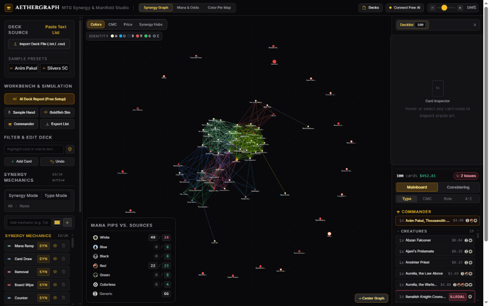
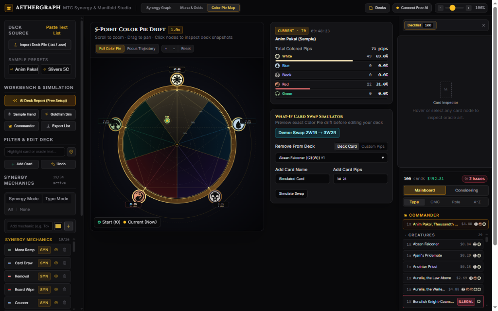
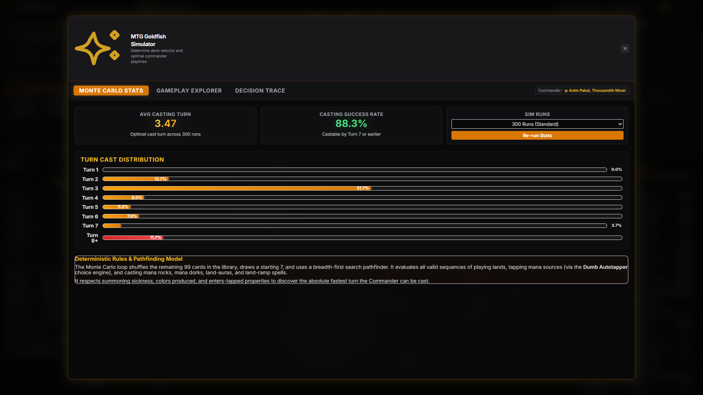
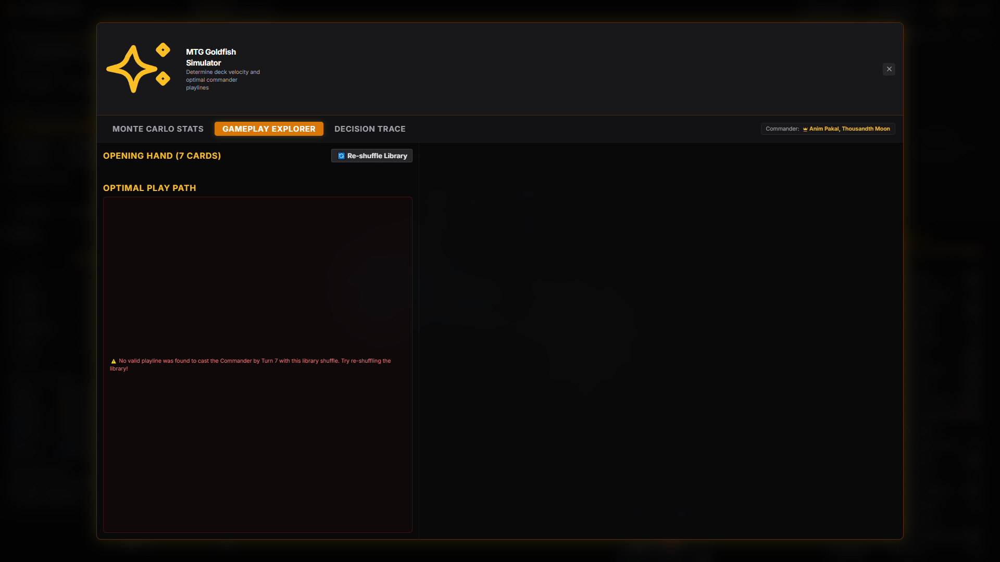
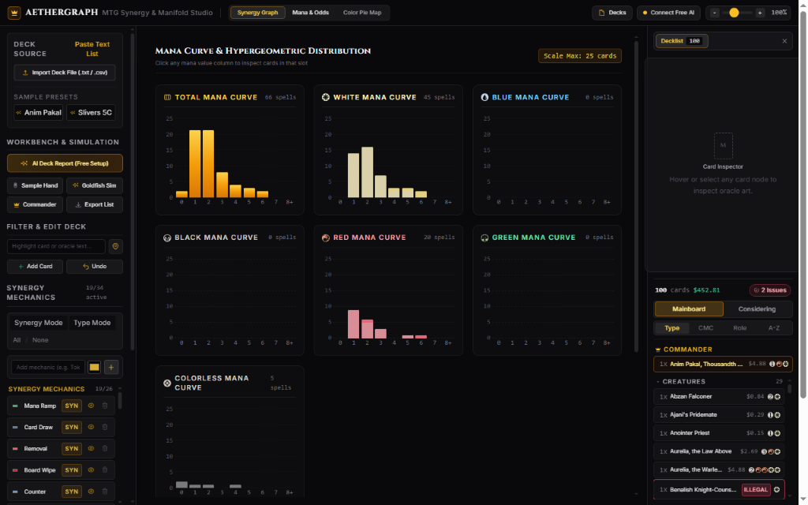
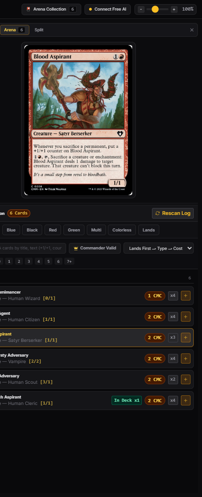

# Aethergraph — MTG Deck Relation Visualizer

> **See your deck the way it actually plays, not as a wall of text.**  
> **[Launch Aethergraph Live →](https://bloopieblair.github.io/MTG-Deck-Relation-Visualizer/)** *(100% free in your browser — no account, no install, no API key needed)*

[](https://bloopieblair.github.io/MTG-Deck-Relation-Visualizer/)
[](https://react.dev/)
[](https://www.typescriptlang.org/)
[](https://vitejs.dev/)
[](https://d3js.org/)
[](https://opensource.org/licenses/MIT)

Every deckbuilder gives you a list. **Aethergraph** gives you an X-ray.

Drop in a Commander, Arena, Moxfield, or CSV list and watch your 100 cards pull themselves into a live **force-directed synergy web**—exposing which engines carry your deck, which pet cards are stranded orphans, how your mana pips drift across the WUBRG Color Pie, and how fast your opening hands actually curve out.



---

## What Makes Aethergraph Different

### 🕸️ Synergy Graph & Live Heatmaps
Static lists hide how cards talk to each other. Aethergraph maps mechanical relationships—*Ramp, Card Draw, Removal, Board Wipes, Tokens, +1/+1 Counters, Sacrifice, Recursion, Blink, Protection, Lifegain, Stax, Landfall, Tutors*—into an interactive D3 network:
* **Synergy Mode by Default**: Highlights mechanical engines cleanly without drowning your screen in creature-to-creature hairballs (with a 1-click toggle back to **Type Mode** whenever you want it).
* **Commander Centricity & Orphan Detection**: Pin your Commander to the center and immediately spot isolated cards or disconnected mini-clusters begging to be cut.
* **Instant Node Heatmaps**: Flip node coloring on the fly—without resetting your layout—between **Color Identity**, **Mana Value (CMC)**, **Budget / USD Price**, and **Synergy Hubs** (link degree).
* **Pinned Multi-Term Search**: Pin up to 3 oracle-text or mechanic searches at once in different highlight colors to see where overlapping packages intersect.

### 🧭 5-Point Color Pie Map & What-If Swap Simulator
Watch your deck's true mana gravity on a WUBRG Color Pie wheel. Track how edits pull your color balance over time, and test hypothetical swaps (*"what happens to my pips if I cut this double-white creature for a red draw spell?"*) before touching your list.



### 🎲 Goldfish Simulator & Early-Game BFS Engine
Forget manually clicking through draw steps one hand at a time. Aethergraph's built-in **Breadth-First Search & Monte Carlo simulator** explores branching Turns 1–7 playlines across hundreds of opening hands—finding the fastest curves to cast your Commander, sequence land drops, and bring mana engines online.




### 📊 Mana Curve, Pips vs. Sources & Hypergeometric Odds
* **Pips vs. Sources**: Spot color-screw traps at a glance by comparing colored pip demand against actual mana production.
* **Interactive Mana Curve**: Click any mana value column to inspect the exact spells sitting at that slot.
* **Hypergeometric Draw Odds**: Exact 7-card opening hand probabilities $P(X \ge 1)$ for every role in your deck.



### 🛠️ Built for Everyday Brewing
* **Live Scryfall Search**: Add cards with debounced Scryfall search, artwork previews, USD pricing, and an optional **Commander Color Identity Legal Only** filter.
* **Smart Decklist Panel**: Group by **Type**, **CMC**, **Role**, or **A–Z**; tweak quantities inline; park brew ideas in a **Considering** board without skewing your curve; and check real-time **Commander legality** (100-card count, singleton, color identity, banlist) alongside estimated TCG USD deck value.
* **Auto-Save, Deck Library & Shareable Links**: Your active brew auto-saves locally, your **Decks** drawer stores multiple lists, and 1-click `#deck=...` URLs let you send a live, interactive synergy graph to your playgroup.
* **1-Click Sample Decks**: Try it immediately with built-in **Boros Aggro (Anim Pakal)** and **5-Color Slivers** presets.
* **MTG Arena Collection Sync (Local)**: Run locally to parse your MTG Arena `Player.log` and browse your owned collection filtered to your Commander's identity.



### 🤖 Optional AI Deck Intelligence (BYOK / Free OpenRouter / Local Ollama)
Want a second pair of eyes on cuts, wincons, and upgrades? Connect **OpenRouter in 1 click (PKCE)** for free models (`Gemini 2.0 Flash`, `DeepSeek R1`, `Llama 3.3 70B`), plug in your own **Google Gemini API key**, or point it at a local **Ollama** instance. Keys stay 100% in your browser's `localStorage`—no backend, no middleman, no subscriptions.

---

## 📁 Repository Structure

```
mtg-deck-relation-visualizer/
├── .github/workflows/             # CI/CD workflows
│   └── deploy.yml                 # Auto-build & deploy to GitHub Pages on push to main
├── components/                    # React UI & D3 Visualization Components
│   ├── DeckVisualizer.tsx         # D3 force-directed synergy graph & heatmap overlays
│   ├── ColorPieMap.tsx            # 5-point WUBRG Color Pie drift & What-If swap studio
│   ├── GoldfishSimulatorModal.tsx # Early-game BFS & Monte Carlo simulator UI
│   ├── ManaCurveDashboard.tsx     # Interactive mana distribution dashboard
│   ├── StatisticalAnalysis.tsx    # Hypergeometric 7-card opening hand odds
│   ├── DeckListView.tsx           # Grouped decklist, Considering zone, pricing & legality
│   ├── AddCardModal.tsx           # Live Scryfall search & card preview modal
│   ├── DeckLibraryModal.tsx       # Local multi-deck library & shareable URL manager
│   ├── KeywordManager.tsx         # Synergy/Type mode presets & custom mechanic editor
│   ├── ApiKeyModal.tsx            # OpenRouter OAuth PKCE, Gemini & Ollama setup
│   ├── DeckAnalysisModal.tsx      # AI strategic report overlay
│   ├── ExportDeckModal.tsx        # Export to Arena, Moxfield, or plain text
│   ├── MtgaCollectionDrawer.tsx   # MTG Arena local collection drawer
│   └── FooterBanner.tsx           # Below-the-fold singles & Ko-fi links
├── services/                      # Data processing & API integrations
│   ├── scryfallService.ts         # Scryfall batch/search API client, caching & auto-tagging
│   ├── deckStorageService.ts      # Local auto-save, deck library CRUD & URL-hash sharing
│   ├── colorPieService.ts         # WUBRG Color Pie geometry, snapshots & swap simulation
│   ├── goldfishSimulator.ts       # BFS & Monte Carlo game-state simulation engine
│   ├── geminiService.ts           # OpenRouter, Google Gemini & Ollama AI integration
│   ├── csvParser.ts               # Robust CSV decklist parser
│   └── parse_mtga.py              # Local MTG Arena log parser script
├── Images/                        # Documentation screenshots
│   ├── Capture.PNG                # Main Synergy Graph interface
│   ├── Capture2.PNG               # Mana curve & draw statistics
│   ├── Capture_ColorPie.PNG       # 5-Point Color Pie Map & swap simulator
│   ├── Capture3.PNG               # MTG Arena collection drawer
│   ├── Capture4.PNG               # Goldfish simulator Monte Carlo stats
│   └── Capture5.PNG               # Goldfish simulator gameplay explorer
├── examples/                      # Sample decklists
│   └── Slivers.txt                # Sample 100-card Commander decklist
├── App.tsx                        # Main application shell & state hub
├── constants.ts                   # Default synergy/type styles & sample decks
├── types.ts                       # TypeScript data models & interface definitions
├── index.html                     # Entry HTML document
├── vite.config.ts                 # Vite build config & MTGA log plugin middleware
├── tsconfig.json                  # TypeScript compiler configuration
└── package.json                   # Project dependencies & npm scripts
```

---

## 🚀 Getting Started

### Option 1: Use the Live Web App (Instant)
Visit **[https://bloopieblair.github.io/MTG-Deck-Relation-Visualizer/](https://bloopieblair.github.io/MTG-Deck-Relation-Visualizer/)** in any modern browser. Click a sample preset or upload/paste your own `.txt` or `.csv` decklist.

### Option 2: Run Locally (Enables Local MTG Arena Log Sync & Ollama)

#### Prerequisites
- **Node.js** (v18.0.0 or higher)
- **Python** (v3.x, optional — only needed for local MTG Arena `Player.log` collection parsing)
- **Ollama** (optional — only needed if running local LLMs offline)

#### Quick Start
1. **Clone the repository**:
   ```bash
   git clone https://github.com/BloopieBlair/MTG-Deck-Relation-Visualizer.git
   cd MTG-Deck-Relation-Visualizer
   ```
2. **Install dependencies & start dev server**:
   ```bash
   npm install
   npm run dev
   ```
   *(Or double-click `start.bat` on Windows / run `./start.sh` on Mac & Linux).*

---

## ☕ Support Development

Aethergraph is free and open source. If it helped you tune a list or cut that one pet card you couldn't let go of, you can optionally support development on **[Ko-fi](https://ko-fi.com/bloopieblair)**.

---

## 🛡️ License

Distributed under the MIT License. See `LICENSE` for more information.
