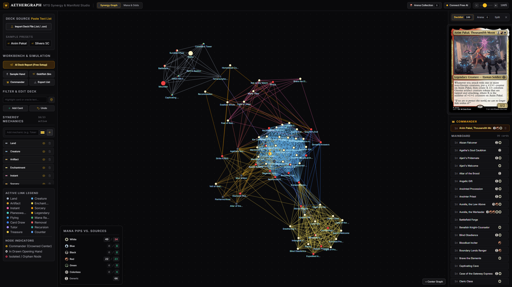
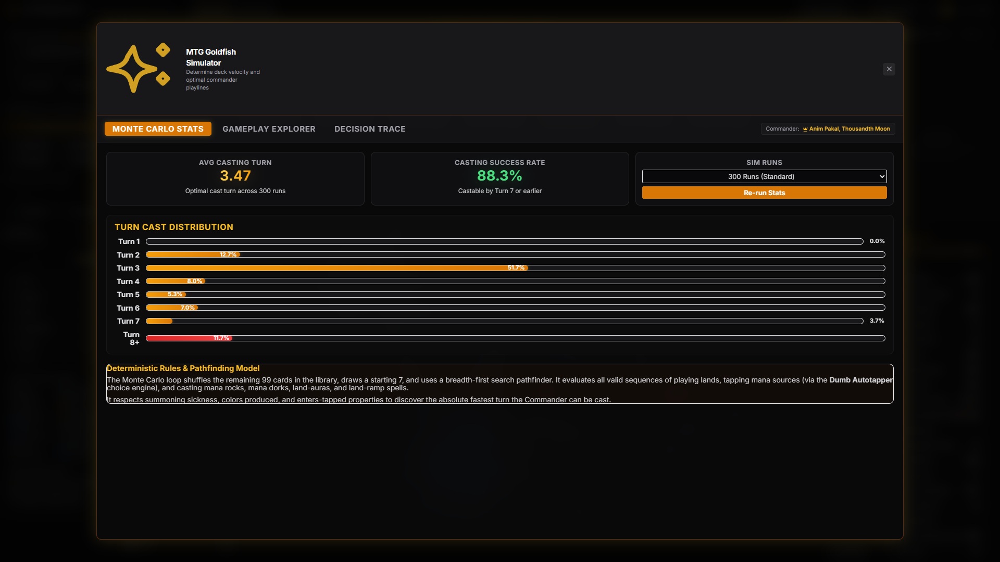
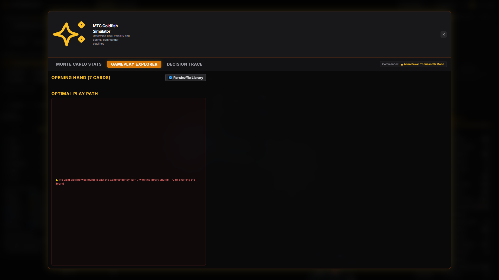
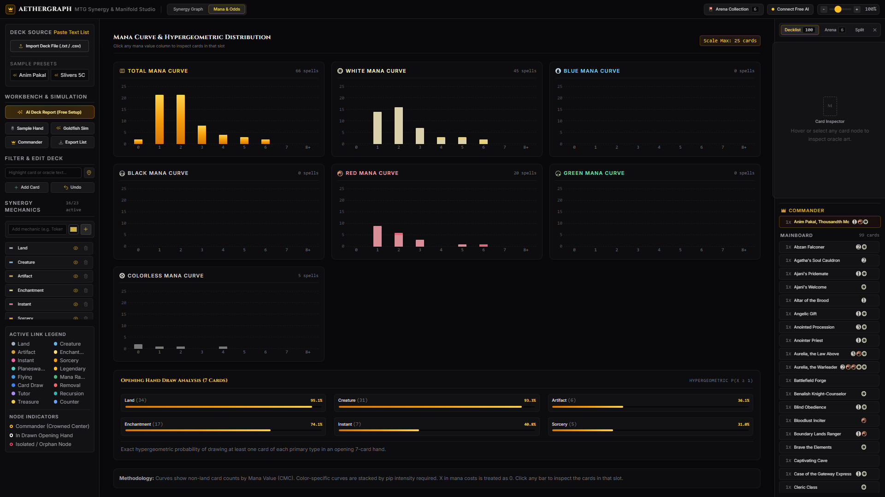
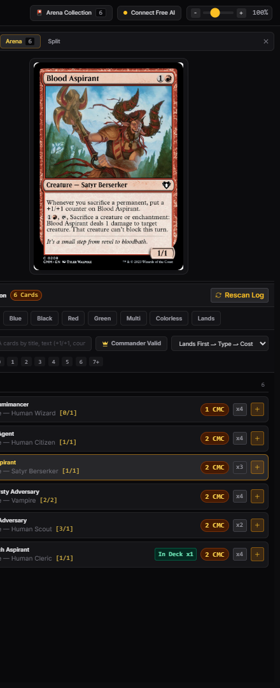

# Aethergraph — MTG Deck Relation Visualizer

> 🎮 **Live Demo:** [https://bloopieblair.github.io/MTG-Deck-Relation-Visualizer/](https://bloopieblair.github.io/MTG-Deck-Relation-Visualizer/)  
> *Launch directly in your browser — 100% free with no install, account, or API key needed.*

[](https://bloopieblair.github.io/MTG-Deck-Relation-Visualizer/)
[](https://react.dev/)
[](https://www.typescriptlang.org/)
[](https://vitejs.dev/)
[](https://d3js.org/)
[](https://openrouter.ai/)
[](https://ai.google.dev/)
[](https://opensource.org/licenses/MIT)

An interactive synergy manifold and analytical studio for **Magic: The Gathering** deckbuilding. Transform static decklists (Arena, Moxfield, CSV, or Commander formats) into dynamic **force-directed graphs** that map out card synergies, mechanical engines, hypergeometric draw odds, and early-game playlines.

👉 **Live Demo:** **[https://bloopieblair.github.io/MTG-Deck-Relation-Visualizer/](https://bloopieblair.github.io/MTG-Deck-Relation-Visualizer/)** *(100% free in your browser — no login or API key required for deck graphing, Scryfall lookup, Mana Curve, or Goldfish simulations).*



---

## 🌟 Key Features

### 🕸️ 1. Interactive Synergy Mapping
* **D3 Force-Directed Network**: Visualizes cards as interactive nodes linked by shared mechanical keywords (e.g. *Flying*, *Mana Ramp*, *Card Draw*, *Removal*, *Tutor*, *Recursion*, *+1/+1 Counter*).
* **Curved Multi-Links**: When cards share multiple mechanics, connections render as non-overlapping curved paths colored by mechanic type.
* **Commander Centricity**: Designate your Commander to pin it at the center of the graph with a Mythic Gold crown badge, showing how your deck orbits its primary engine.
* **Orphan & Weak Connection Highlighting**: Instantly detect isolated card clusters or cards with only a single connection to the rest of the deck for streamlining cuts.

### 🤖 2. OpenRouter, Gemini & Local Ollama AI Deck Intelligence
* **1-Click OpenRouter Connect (PKCE)**: Connect your OpenRouter account in one click to run AI deck evaluations using **100% free models** (`Google Gemini 2.0 Flash Free`, `DeepSeek R1 Free`, `Llama 3.3 70B Free`) or bring your own Google Gemini API key / local Ollama server.
* **Zero Middleman Fees**: All keys stay strictly in your browser's `localStorage` and communicate directly with OpenRouter, Google AI, or your local Ollama instance.
* **Strategic Deck Analysis**: Generates comprehensive AI deck reports evaluating archetype, power level (1–10), curve balance, win conditions, orphan cuts, and high-synergy upgrade recommendations.

### 🎲 3. Goldfish Simulator & Early-Game BFS Engine
* **Breadth-First Search Pathfinder**: Simulates hundreds of opening-hand play sequences across Turns 1–7.
* **Fastest-Path Strategy**: Finds optimal card play paths to cast your Commander on curve, establish mana engines, and sequence land drops.
* **Visual State Tree**: Explore branching decision nodes interactively to test goldfishing velocity.




### 📊 4. Mana & Statistical Dashboard
* **Mana Pip vs. Source Breakdown**: Compares total colored mana symbol requirements against land mana production capacity.
* **Hypergeometric Probability Calculator**: Computes exact opening 7-card hand draw odds $P(X \ge 1)$ for every card category.
* **Interactive Mana Curve**: Inspect deck distribution across Mana Values (CMC) and colored pip intensity with detailed popup card lists.



### 🔍 5. Discovery Tools & MTG Arena Collection Sync
* **1-Click Sample Decks**: Instantly test the graph in your browser with built-in **Boros Aggro (Anim Pakal)** and **5-Color Slivers** presets.
* **Pinned Multi-Term Search**: Pin up to 3 search terms simultaneously with color-coded node highlights to inspect synergy overlaps.
* **Scryfall High-Res Card Previews**: Hover or click any node to pull high-resolution card artwork, Oracle text, and mana breakdowns via the Scryfall API.
* **MTG Arena Collection Drawer**: When running locally, sync your MTG Arena `Player.log` and SQLite card database to browse owned cards and filter by Commander color identity.



---

## 📁 Repository Structure

```
mtg-deck-relation-visualizer/
├── components/                    # React UI & D3 Visualization Components
│   ├── DeckVisualizer.tsx         # D3 force-directed network graph engine
│   ├── GoldfishSimulatorModal.tsx # Early-game BFS decision tree simulator
│   ├── ManaCurveDashboard.tsx     # Interactive mana distribution dashboard
│   ├── StatisticalAnalysis.tsx    # Hypergeometric 7-card opening hand odds
│   ├── KeywordManager.tsx         # Custom keyword color & link rule editor
│   ├── ApiKeyModal.tsx            # OpenRouter OAuth PKCE, Gemini & Ollama setup
│   ├── DeckAnalysisModal.tsx      # AI strategic report overlay
│   ├── ExportDeckModal.tsx        # Export to Arena, Moxfield, or plain text
│   ├── MtgaCollectionDrawer.tsx   # MTG Arena local collection drawer
│   └── FooterBanner.tsx           # Below-the-fold singles & Ko-fi links
├── services/                      # Data processing & API integrations
│   ├── scryfallService.ts         # Scryfall REST API client with caching & batching
│   ├── geminiService.ts           # OpenRouter, Google Gemini & Ollama AI integration
│   ├── goldfishSimulator.ts       # BFS game state simulation engine
│   ├── csvParser.ts               # Robust CSV decklist parser
│   └── parse_mtga.py              # Local MTG Arena log parser script
├── Images/                        # Documentation screenshots
│   ├── Capture.PNG                # Main visualizer interface
│   ├── Capture2.PNG               # Mana curve & draw statistics
│   ├── Capture3.PNG               # MTG Arena collection drawer
│   ├── Capture4.PNG               # Goldfish simulator Monte Carlo stats
│   └── Capture5.PNG               # Goldfish simulator gameplay explorer
├── examples/                      # Sample decklists
│   └── Slivers.txt                # Sample 100-card Commander decklist
├── App.tsx                        # Main application shell & state hub
├── constants.ts                   # Default keyword definitions & sample decks
├── types.ts                       # TypeScript data models & interface definitions
├── index.html                     # Entry HTML document
├── vite.config.ts                 # Vite build config & MTGA log plugin middleware
├── tsconfig.json                  # TypeScript compiler configuration
└── package.json                   # Project dependencies & npm scripts
```

---

## 🚀 Getting Started

### Option 1: Use the Live Web App (Instant)
Visit **[https://bloopieblair.github.io/MTG-Deck-Relation-Visualizer/](https://bloopieblair.github.io/MTG-Deck-Relation-Visualizer/)** in any modern browser. Click a sample preset or upload/paste your own `.txt` or `.csv` decklist.

### Option 2: Run Locally (Enables Local MTG Arena Log Sync & Ollama)

#### Prerequisites
- **Node.js** (v18.0.0 or higher)
- **Python** (v3.x, optional — only needed for local MTG Arena `Player.log` collection parsing)
- **Ollama** (optional — only needed if running local LLMs offline)

#### Quick Start
1. **Clone the repository**:
   ```bash
   git clone https://github.com/BloopieBlair/MTG-Deck-Relation-Visualizer.git
   cd MTG-Deck-Relation-Visualizer
   ```
2. **Install dependencies & start dev server**:
   ```bash
   npm install
   npm run dev
   ```
   *(Or double-click `start.bat` on Windows / run `./start.sh` on Mac & Linux).*

---

## ☕ Support Development

This project is free and open source. If it saved you time or helped you tune a deck, you can optionally support continued development on **[Ko-fi](https://ko-fi.com/bloopieblair)**.

---

## 🛡️ License

Distributed under the MIT License. See `LICENSE` for more information.
